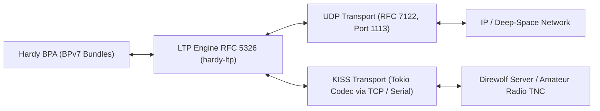
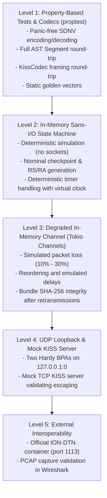

# Licklider Transmission Protocol (LTP) Convergence Layer Adapter (CLA)

This document brings together the specifications, comparative analysis of reference implementations (ION-DTN and licklider), target multi-framing architecture (UDP and KISS server link), and progressive validation strategy using property-based testing (`proptest`) for integrating LTP (RFC 5326) as a Convergence Layer Adapter (CLA) for Hardy.

---

## 1. Standards and Specifications

LTP is the convergence layer protocol designed specifically for links with very long propagation delays (high RTT, interplanetary delays, or asymmetric space/satellite/radio links).

### 1.1 Reference Documents

- **RFC 5325**: *Licklider Transmission Protocol - Motivation* (Informational)
  Explains the genesis of LTP, the constraints of long round-trip time (RTT) links, bandwidth asymmetry, and the lack of prior bidirectional session negotiation.
- **RFC 5326**: *Licklider Transmission Protocol - Specification* (Standards Track)
  Core protocol specification: segment format, session types, Red (reliable with acknowledgments and retransmissions) and Green (unreliable) transmission, checkpoint handling, Report Segments (RS), Report Acknowledgments (RA), Cancel Segments (CS), and timers.
- **RFC 5327**: *Licklider Transmission Protocol - Security Extensions* (Standards Track)
  Security extensions for LTP: segment authentication, integrity, and confidentiality at the LTP layer.
- **RFC 7122**: *Datagram Convergence Layers for the Delay-Tolerant Networking (DTN) Bundle Protocol and Licklider Transmission Protocol (LTP)*
  Defines LTP encapsulation over UDP and DCCP. The default IANA-assigned UDP port for LTP is **1113** (`ltp-deepspace`).
- **CCSDS 734.1-B-1**: *Licklider Transmission Protocol (LTP) for CCSDS* (Blue Book, Space Recommendation)
  Profile and standardization of LTP adopted by the Consultative Committee for Space Data Systems (CCSDS), consistent with RFC 5326 with some clarifications on mission usage profiles (32-bit identifier ranges, timers).
- **KISS TNC Protocol** (Mike Chepponis, 1986 / AX.25)
  Framing protocol for amateur radio modems and TNCs (encapsulation using `FEND` framing bytes and `FESC` escaping).

### 1.2 Local Retrieval of Standards

Specifications are archived locally in `references/specs/` (git-ignored directory):

```bash
mkdir -p references/specs
curl -sSL "https://www.rfc-editor.org/rfc/rfc5325.txt" -o references/specs/rfc5325.txt
curl -sSL "https://www.rfc-editor.org/rfc/rfc5326.txt" -o references/specs/rfc5326.txt
curl -sSL "https://www.rfc-editor.org/rfc/rfc5327.txt" -o references/specs/rfc5327.txt
curl -sSL "https://www.rfc-editor.org/rfc/rfc7122.txt" -o references/specs/rfc7122.txt
curl -sSL "https://public.ccsds.org/Pubs/734x1b1.pdf" -o references/specs/ccsds-734.1-b-1.pdf
```

---

## 2. Reference Repositories and Retrieved Source Code

The following repositories were cloned into `references/` for analysis and reverse engineering:

```bash
# 1. Modern sans-I/O Rust implementation (MIT / Apache-2.0)
git clone --depth 1 https://github.com/wowinter13/licklider.git references/licklider

# 2. NASA (JPL) reference C implementation
git clone --depth 1 https://github.com/nasa-jpl/ION-DTN.git references/ion-dtn

# 3. Official Wireshark dissector
curl -sSL "https://gitlab.com/wireshark/wireshark/-/raw/master/epan/dissectors/packet-ltp.c" -o references/packet-ltp.c
```

---

## 3. Comparative Analysis and Key Implementation Highlights

Detailed study of existing implementations (`ION-DTN` and `licklider`) highlights several architectural choices and protocol subtleties essential for a rock-solid implementation in Hardy.

### 3.1 Highlights of `licklider` (Rust)

The `licklider` project offers a remarkable decomposition and documents its choices in its `DECISIONS.md` log. Key points:

1. **Sans-I/O Paradigm (`licklider-core`)**:
   The protocol engine is a pure state machine devoid of any socket, thread, or async runtime (`poll_output(now)` / `handle_incoming_segment`). This allows total isolation of protocol logic and instant, deterministic test execution.
2. **Greedy Segmentation and MTU (D-1)**:
   Splitting the block into data segments not exceeding `max_segment_len` (1400 bytes by default over IP to avoid fragmentation). Strict rule: a segment never straddles the Red/Green boundary (byte `red_len` strictly starts the first Green segment).
3. **Checkpoint Frequency (D-2)**:
   Only the end-of-Red-block segment (End of Red Part - EORP / End of Block - EOB) carries the Checkpoint flag by default. Intermediate checkpoints are unnecessary on most links and complicate state management.
4. **Strict Policy on SDNVs and Malformed Segments (D-4)**:
   Strict 10-byte cap for any SDNV (sufficient for any `u64`). Silent drop with metric counter increment for corrupted segments (in accordance with the preamble of Section 6 of RFC 5326).
5. **Unconditional Acknowledgment of Report Segments (D-6)**:
   A `Report Acknowledgment` (RA) is **always emitted first**, even if the received `Report Segment` (RS) pertains to a closed or unknown session or is a duplicate. If the RA were not emitted, the receiver would remain blocked indefinitely waiting for an acknowledgment.
6. **Limiting the Number of Claims per Report (D-7)**:
   Cap of 20 *claims* per RS (modeled on ION's `MAX_CLAIMS_PER_RS`). If a report requires more claims, it is partitioned into multiple contiguous RSs covering disjoint ranges.
7. **Anti-Replay Cache for Closed Sessions (D-10)**:
   Bounded FIFO cache (1024 recent sessions) to prevent a delayed data segment from being mistaken for a new phantom session after closure.
8. **Immediate Green Delivery (D-12)**:
   Green segments are passed immediately to the BPA upon reception, without waiting for the rest of the block and without zero-filling gaps (unlike ION).
9. **Byte-Volume-Bounded Retransmission (D-20)**:
   Gap calculation and retransmission are performed strictly within the *scope* of the received RS. The retransmission cap is measured in cumulative byte volume to prevent infinite loops under heavy reordering.

### 3.2 Highlights of `ION-DTN` (C / NASA JPL)

NASA's space reference implementation is built on foundations designed for hardware fault tolerance:

1. **Shared Memory Persistence (SDR - Simple Data Recorder)**:
   All LTP blocks and session states are kept in a transactional shared-memory SDR store, capable of restarting after a system crash without data loss.
2. **Multi-Process Architecture**:
   - `ltpclock`: Central daemon managing timers, checking timer expirations, and triggering periodic retransmissions.
   - `ltpmeter`: Rate regulator to respect contact transmission windows (space contact plans).
   - `ltpdeliv`: Daemon handling final block assembly and injection into the local BPA.
   - `udplsi` / `udplso`: UDP input and output daemons on port 1113.
3. **Critical System Constants**:
   - `MAX_CLAIMS_PER_RS = 20`: Fixed limit in ION ensuring a UDP packet does not exceed the standard MTU.
   - Span management: Pre-configuration of each neighbor (remote engine ID, MTU, One-Way Light Time - OWLT).
4. **Specific Green Behavior**:
   In ION, missing Green segments during reassembly are filled with `0x00` bytes before delivery to the BPA.

---

## 4. Multi-Framing: UDP and KISS Server Support

Hardy's LTP CLA adapter must adapt to two distinct transport environments:



### 4.1 UDP Datagram Transport (RFC 7122)
- **Format**: 1 UDP datagram = 1 raw LTP segment.
- **IANA Port**: Standard UDP port **1113** (`ltp-deepspace`).
- **Behavior**: No extra encapsulation header or trailer. The first byte of the UDP payload is the LTP header byte (segment type and flags).

### 4.2 KISS Framed Transport (TCP Server Connection / Amateur Radio)
- **Use Case**: Amateur packet radio links (AX.25, VHF/UHF, CubeSat/AmSat satellite links) via a hardware or software TNC (such as **Direwolf**). LTP provides the reliable transport layer (selective Red retransmissions) over a half-duplex radio modem.
- **KISS Encapsulation Principle**:
  - Frame delimiter `FEND`: `0xC0` (at the start and end of each segment).
  - KISS command byte: `0x00` (Port 0, data frame).
  - Byte stuffing inside the LTP segment:
    - Byte `0xC0` is replaced by the 2-byte sequence `0xDB 0xDC` (`FESC` + `TFEND`).
    - Byte `0xDB` is replaced by the 2-byte sequence `0xDB 0xDD` (`FESC` + `TFESC`).
- **Tokio Implementation**:
  - Implementation of a `KissCodec` via `tokio_util::codec::{Encoder, Decoder}`.
  - Asynchronous `TcpStream` client connection to the KISS server (e.g., `127.0.0.1:8001` exposed by Direwolf) or to a serial port (`tokio-serial`).
  - Each frame deframed by the KISS codec produces an LTP segment injected directly into the sans-I/O engine.

---

## 5. Progressive Validation Strategy (from Simplest to Integration Tests)

In accordance with Hardy's rules, the test suite must be strictly **deterministic**, free of arbitrary time dependencies (`sleep` prohibited, virtual clock), 32-bit compatible, and rely heavily on **property-based testing (`proptest`)** starting from the first level.



### 5.1 Level 1: Property-Based Validation (`proptest`) and Fixed Vectors

Level 1 uses no threads or network resources. It validates mathematical and robustness invariants via `proptest`:

1. **SDNV (Self-Delimiting Numeric Values) Invariants**:
   - *Round-trip*: `sdnv::decode(&sdnv::encode(v)) == Ok((v, len))` for any `v: u64`.
   - *Minimal canonicity*: Canonical encoding never has a redundant leading `0x80` byte for `v > 0`.
   - *Complete panic freedom*: For any arbitrary byte sequence `bytes in proptest::collection::vec(any::<u8>(), 0..32)`, `sdnv::decode(&bytes)` returns `Ok` or `Err`, but **never** panics.
   - *32-bit / 64-bit overflow detection*: Rejects values exceeding `u64::MAX` or exceeding 10 bytes.
2. **LTP Segment Codec Invariants**:
   - Proptest generation of arbitrary segments (Red Data with variable offsets, Green Data, Checkpoints, RS with claim list, RA, Cancel Segments).
   - *AST Round-trip*: `Segment::decode(&segment.encode()) == Ok(segment)`.
   - *Fuzzing tolerance*: Clean rejection of any invalid preamble or truncated length.
3. **KISS Framer Invariants (`KissCodec`)**:
   - *Escaping round-trip*: Any arbitrary segment encoded into a KISS frame and then decoded must yield the exact same segment, even if it contains repeated sequences of `0xC0` or `0xDB` bytes.
4. **Static Golden Vectors**:
   - Fixed hexadecimal vectors extracted from RFC 5326 and Wireshark PCAP captures to guarantee bit-exact compliance.

### 5.2 Level 2: In-Memory Sans-I/O State Machine

- Step-by-step driven protocol engine: manual injection of segments (`feed_input`) and extraction of segments to transmit (`poll_output`).
- *Nominal Red Cycle*: Block submission $\rightarrow$ emission of data segments with CP flag $\rightarrow$ automatic RS calculation by receiver $\rightarrow$ RS reception by sender $\rightarrow$ immediate RA emission $\rightarrow$ session completion on both sides.
- *Deterministic Retransmission*: Artificial drop of a segment in the sequence $\rightarrow$ verification that the RS contains the exact missing range $\rightarrow$ verification that the sender only retransmits the missing range.
- *Virtual Clock Timers*: Manual advancement of logical time (`now += owlt * 2 + margin`) to test timer expirations without any `sleep`.

### 5.3 Level 3: Degraded In-Memory Channel (Async Link Simulation)

- Two LTP engines connected via Tokio memory channels (`mpsc`).
- Configurable link impairment stub:
  - Configurable loss rate (e.g., random 15% packet drop).
  - Reordering and duplication.
  - Simulated delays using Tokio's virtual clock (`tokio::time::pause()` and `tokio::time::advance()`).
- Success assertion: Computation of the SHA-256 digest of the sent bundle and verification of its strict identity with the bundle reassembled at the destination.

### 5.3bis Cross-Validation with `licklider-core` (Immediate Interoperability)

To validate RFC 5326 compliance without waiting for the network CLA or a heavy external container:
- **Bidirectional communication**:
  - `hardy-ltp` as Sender -> Impairment stub -> `licklider-core` as Receiver.
  - `licklider-core` as Sender -> Impairment stub -> `hardy-ltp` as Receiver.
- **Tested conditions (`ltp/tests/interop_licklider.rs`)**:
  - *Nominal*: Lossless 32 KiB transfer, 1024-byte MTU segmentation, SHA-256 verification.
  - *Degraded*: Transfer under **15% symmetric random loss** + 5% duplication + latency jitter. Gap retransmission, checkpoints, and mutual acknowledgments.
  - Exact equality assertion of SHA-256 hashes of transmitted and received data.

### 5.4 Level 4: UDP Loopback & Local KISS Client/Server

- Integration into the Hardy BPA runtime (`hardy_bpa::cla::Cla`).
- *UDP Test*: Two BPA instances listening on ephemeral UDP ports `127.0.0.1:0`. Routing a complete bundle to the remote EID and verifying [`ForwardBundleResult::Accepted`](file:///home/loic/projets/hardy/bpa/src/cla/mod.rs#L195) and [`TransferOutcome::Completed`](file:///home/loic/projets/hardy/bpa/src/cla/mod.rs#L211) outcomes.
- *KISS Test*: Starting a local TCP server task simulating a KISS TNC, verifying proper connection of the Hardy CLA client, correct framing, and bundle exchange.

### 5.5 Level 5: External Interoperability Validation (ION-DTN & Wireshark)

- **Environment**: Official ION 4.1.4 Docker image (`ion-interop`) running locally on UDP port 1113.
- **Tested exchanges (`tests/interop/ION/test_ion_ltp_ping.sh`)**:
  - *Test 1 (Hardy -> ION)*: Hardy's `bp ping` CLI tool configured with `--cla ltp` to the ION echo service (`ipn:2.7`), 5/5 bundles routed successfully, 0% loss, RTT ~1.4 ms.
  - *Test 2 (ION -> Hardy)*: `bpsendfile` and `bpecho` from ION to Hardy (`ipn:1.7`), 5/5 bundles received and acknowledged with zero loss.
- **Wireshark/tshark Dissection Validation (`packet-ltp.c`)**:
  - Live `.pcap` capture via `tcpdump`.
  - Full dissection under `tshark` confirming the absence of any malformation on exchanged LTP segments (Red Data, Checkpoint, Report Segments, Report ACKs).
- **UDP Ephemeral Port Adaptation**: Detection and dynamic learning of ION's ephemeral source ports (`udplso`) for associating inbound/outbound sessions.

---

## 6. Target Architecture, `no_std`, and Feature Gates in Hardy

In accordance with Hardy's core rules (`AGENTS.md`):
> `no_std core. cbor, bpv7, and bpa are no_std + alloc; gate std behind a feature, don't assume it.`  
> `32-bit safe. Hardy targets 32-bit. Never as usize a wire-derived u64 length — compare in u64 first, then try_from.`

LTP support is split into two levels of responsibility:

### 6.1 Engine Crate: `ltp` (`hardy-ltp`) — `no_std` + `alloc`
The `hardy-ltp` crate contains all RFC 5326 protocol intelligence and KISS framing, with no ties to the operating system or network runtime:
- **`#![no_std]` by default**: The root `lib.rs` declares `#![no_std]` with `extern crate alloc;`.
- **Sans-I/O Time Management**: The engine never uses `std::time::Instant`. It manipulates a logical clock type (e.g., an integer timestamp in microseconds `u64`), passed as a parameter to state machine advancement functions (`poll_output(now)`).
- **Deterministic Randomness**: No calls to `rand::thread_rng()`. The engine receives either an initialization seed or an abstract generator via a dedicated trait (`RngCore` or embedded PCG32), making sessions simulatable and reproducible.
- **32-bit Safety**: All block offsets, segment lengths, and SDNV serials are validated in `u64` arithmetic before any careful conversion to `usize`.
- **Planned Feature Gates in `ltp/Cargo.toml`**:
  ```toml
  [package]
  name = "hardy-ltp"
  version = "0.1.0"
  edition.workspace = true
  rust-version.workspace = true
  license.workspace = true

  [features]
  default = ["std", "kiss"]
  std = ["thiserror/std", "bytes/std"]
  serde = ["dep:serde", "serde/alloc"]
  kiss = [] # Pure KISS codec module (100% no_std)

  [dependencies]
  thiserror = { version = "2", default-features = false }
  bytes = { version = "1", default-features = false }
  serde = { version = "1", default-features = false, features = ["derive"], optional = true }

  [dev-dependencies]
  proptest = "1"
  ```

### 6.2 Adapter Crate: `ltp-cla` (`hardy-ltp-cla`) — `std` + `tokio`
The CLA adapter plugs into Hardy's execution ecosystem:
- **Environment**: Crate depending on `std`, `tokio`, and `hardy-bpa`.
- **Implementation of `hardy_bpa::cla::Cla`**:
  - Adapts BPA segment streams to LTP blocks.
  - Declares its characteristics via `ClaInit` (lane count, max bundle size).
  - Returns `ForwardBundleResult::Accepted` and signals transfer completion via `sink.transfer_outcome(bundle_id, TransferOutcome::Completed)` upon full block acknowledgment (reception of final RS and emission of RA).
- **Link Subsystems**:
  - `UdpLink`: asynchronous UDP link via `tokio::net::UdpSocket` (RFC 7122).
  - `KissLink`: asynchronous link via `tokio::net::TcpStream` to a KISS server (Direwolf) or serial link, using a framed codec derived from `hardy-ltp`'s KISS module.
  - **TCP Resilience & Retry Backoff (as in TCPCLv4)**:
    - Hot-handled disconnection (remote EOF or I/O error) without crashing or terminating the driver task.
    - Automatic reconnection attempts with **exponential backoff** (initial delay `reconnect-initial-delay` doubled on each failure up to a cap `reconnect-max-delay`, reset upon successful reconnection).
    - `TCP_NODELAY` enabled to eliminate Nagle latencies on small critical segments (ACKs, CP).
    - Continued processing of BPA commands (`Forward`, `RegisterPeer`) and LTP clock ticks during the disconnected phase: pending blocks are retained in the LTP engine and automatically transmitted as soon as the KISS link is restored.
- **Declarative Configuration (`bpa-server`)**:
  - Integrated into `hardy-bpa-server`'s YAML schema (`clas: - type: ltp`).
  - Full parameter definition: `engine-id`, `max-segment-payload-len`, `humantime` durations (`rtt`, `ack-margin`), retransmission limits (`checkpoint-rtx-limit`, `report-rtx-limit`), transport (`udp` or `kiss-tcp`), reconnection parameters (`reconnect-initial-delay`, `reconnect-max-delay`), and static peer mapping (`peers: - engine-id, address, node-id`).
  - Documented example file available in `ltp-cla/example_config.yaml`.

### 6.3 CI Check for `no_std`
To ensure no implicit dependency on `std` is introduced into `hardy-ltp`, CI validation will rely on:
```bash
cargo check -p hardy-ltp --no-default-features
# Or cross-compilation on an embedded bare-metal target:
cargo check -p hardy-ltp --no-default-features --target thumbv7em-none-eabihf
```

---

## 7. High Goodput Optimizations and Autovectorization

To achieve very high effective throughput (*goodput*) and avoid CPU bottlenecks on fast links:

### 7.1 Autovectorization and Block Copying in KISS Framing
- **Initial Problem**: A byte-by-byte loop with branching (`match b { FEND => ..., other => ... }`) and individual `push()` calls prevents SIMD vectorization and multiplies vector capacity checks.
- **Implemented Solution**:
  - **`escape`**: Capacity pre-reservation (`out.reserve(input.len())`) and contiguous range scanning. Sequences without special characters are block-copied via `out.extend_from_slice(&input[start..i])`, compiled to vectorized `memcpy` (AVX2/NEON).
  - **`unescape`**: Vectorized fast-path `if !input.contains(&FESC)` enabling direct decoding at memory bandwidth speed (~10-20 GiB/s) for typical frames without escape sequences.

### 7.2 Zero Reallocation and Stack-Allocated SDNV Encoding
- **`sdnv::encode_to_array`**: Direct encoding into a fixed `[u8; 10]` stack-allocated array, avoiding any heap allocation for SDNV integers.
- **`Segment::exact_encoded_len`**: Pre-calculation of the exact byte size of the segment to serialize. The vector memory is allocated in one shot with zero intermediate reallocations.

### 7.3 Performance Benchmark Suite (`cargo bench`)
A comprehensive Criterion benchmark suite is configured in `ltp/benches/ltp_bench.rs` covering:
- SDNV encoding and decoding (1-byte, multi-byte, `u64::MAX`).
- KISS escaping and unescaping throughput (1 KiB, 64 KiB) measured with `Throughput::Bytes`.
- Full round-trip of MTU-sized KISS frames (1400 bytes).
- Serialization and deserialization of MTU data segments (1400 bytes) and complex report segments (20 claims).

Running the benchmark:
```bash
cargo bench -p hardy-ltp
```

---

## 8. Progress and Next Actions

- [x] Initialize the `ltp` (`hardy-ltp`) crate in the Cargo workspace (`#![no_std]`).
- [x] Implement the `sdnv` module (32-bit safe, `encode_to_array`) with `proptest` tests.
- [x] Implement the `kiss` module (autovectorized, SIMD fast-path) with `proptest` tests.
- [x] Develop the RFC 5326 segment AST and codec with golden vectors.
- [x] Set up the `cargo bench` benchmark suite (Criterion).
- [x] **Level 2**: Pure sans-I/O state machine (`Engine`, `SendSession`, `RecvSession`, retransmissions, checkpoints, virtual clock, 5 deterministic integration tests).
- [x] **Level 3**: In-memory impairment stub (`ltp/tests/impairment_channel.rs`: 15% loss, duplication, delay jitter, SHA-256 integrity validation on 64 KiB blocks).
- [x] **Level 3bis**: Cross-interoperability validation with `licklider-core` (`ltp/tests/interop_licklider.rs`: bidirectional Hardy <-> Licklider nominal and under 15% loss).
- [x] **Level 4**: Hardy BPA CLA adapter (`hardy-ltp-cla` with RFC 7122 UDP and KISS TCP, validated on loopback).
- [x] **Integration & Configurability**: Support for `type: ltp` in `hardy-bpa-server` YAML config, `humantime` serde parsing, configuration unit tests, and example file `ltp-cla/example_config.yaml`.
- [x] **Level 5**: External interoperability tests (ION-DTN 4.1.4, 100% successful bidirectional ping, Wireshark/tshark dissection validated).

---

## 9. Critical Implementation Review and Resolutions

In-depth code review of `ltp/` and `ltp-cla/` (`feat/ltp-cla` branch) with applied fixes. Severity: **[CRITICAL]** = panic/OOM/hang remotely triggerable by a single datagram or stream fragment, **[MAJOR]** = functional incorrectness or realistic resource leak, **[MINOR]** = robustness, performance, or debt.

> [!IMPORTANT]
> **Explicit Architectural Choice — Raw LTP Framing over KISS (no AX.25)**:
> Frames transmitted over KISS encapsulate **only and directly raw LTP segments** in KISS data frames (`Command::Data`, Command 0), with no AX.25 header or encapsulation (no callsign, no control field, no PID). This deliberate architectural decision eliminates AX.25 overhead on constrained RF links to maximize effective goodput. If periodic amateur radio callsign identification is required by regulation, it is handled by the physical modem/TNC or an external beacon, not by the LTP protocol.

### 9.1 Panics and Driver Shutdowns

- [x] **[CRITICAL] Clamping of report gaps (resolved)**: In `Engine::handle_incoming_report`, `upper_bound` and `lower_bound` are systematically clamped to `red_len.min(block.len())`. Retransmission slices are checked against `session.block.len()`, eliminating any out-of-bounds indexing panic risk.
- [x] **[CRITICAL] Block size and offset bounds (resolved)**: `RecvSession::insert_red` now checks `offset.checked_add(data.len())` and rejects any segment exceeding `max_block_size` (64 MiB by default in `EngineConfig`). `request_transmission` also rejects blocks exceeding this size with `Error::BlockTooLarge`.
- [x] **[CRITICAL] Arithmetic overflow on incoming data (resolved)**: `ds.offset.checked_add(ds.data.len() as u64)` and `saturating_add` are applied to all segment bound calculations; `insert_red` is checked and if insertion fails the segment is ignored.
- [x] **[CRITICAL] Panic-free CLA driver startup (resolved)**: In `ltp-cla/src/cla.rs::on_register`, `addr_rx.await` receives a `Result<SocketAddr, std::io::Error>`. Upon network bind failure (port already in use or invalid address), the error is logged without panicking the BPA server.
- [x] **[CRITICAL] Transmission parameter validation (resolved)**: `max_block_size` and configuration limits added in `EngineConfig` with sane defaults.
- [x] **[MINOR] Saturating arithmetic on KISS backoff (resolved)**: `current_delay.saturating_mul(2).min(reconnect_max_delay)` prevents any `Duration` overflow panic risk.
- [x] Parser: `Cursor::bytes` uses `try_from` + `checked_add`, bounded `Vec::with_capacity` (`MAX_PARSED_CLAIMS`, `claim_count <= remaining/2`), claims bounded by `upper_bound - lower_bound` ⇒ `lower_bound + claim.offset + claim.length` cannot overflow in the engine.
- [x] SDNV: 10-byte cap, overflow check before shift (`acc >> 57`), no out-of-bounds indexing.

### 9.2 Protocol Correctness (RFC 5326)

- [x] **[MAJOR] Closed session memory and anti-duplication (resolved)**: A bounded ring buffer (`closed_recv_sessions_set`, 1024 entries) remembers completed receive session IDs. Any duplicate or delayed checkpoint re-emits the report acknowledgment without ever re-emitting a duplicate `Notice::RedPartReceived` to the BPA.
- [x] **[MAJOR] Cancellation timers and retransmission (resolved)**: `TimerKey::Cancel { session, is_sender }` integrated into `TimerTable`. Cancel segments CS and CR are retransmitted up to `cancel_rtx_limit` on timer expiration, and disarmed upon receiving `CancelAckSender` or `CancelAckReceiver`.
- [x] **[MAJOR] Configurable session number (resolved)**: `initial_session_number: u64` added to `EngineConfig`, allowing injection of a random starting point.
- [x] **[MAJOR] Session originator validation (resolved)**: `SessionId.originator` is checked against sender `from` for data segments and sender cancellations, and against the local engine ID for reports and receiver cancellations. Spoofed segments are rejected without corrupting active sessions.
- [x] **[MINOR] Unblocking sender on gapless partial report (resolved)**: When a partial report contains no gaps (`gaps.is_empty()`) but the block is not yet fully acknowledged and no CP is in flight, a new checkpoint is re-emitted to restart the dialogue.
- [x] **[MINOR] Support for `claim_count == 0` and adjacent claims (resolved)**: Compliant with RFC 5326 §3.2.2, `parse_report` accepts `claim_count == 0` (zero bytes received in scope) and allows adjacent claims (`offset < prev_end` instead of `<=`).
- [x] Retransmission of CP and RS with the same serial numbers, unconditional RA, report deduplication by `report_serial`, range sorting/merging (`RangeSet`): covered by golden, engine, impaired channel (15% loss, duplicates, jitter), and `licklider-core` interoperability tests.

### 9.3 Memory Consumption and Leaks

- [x] **[MAJOR] Session inactivity cleanup (resolved)**: `session_inactivity_timeout_micros` (default 60 s) sweeps inactive sessions in `handle_timer_tick`. Any stalled session is cleanly cancelled (`Rlexc`) and releases its resources. `next_timer_deadline` anticipates this deadline.
- [x] **[MAJOR] Per-block memory cap (resolved)**: `max_block_size` (default 64 MiB) protects assembly buffers against forged high-offset segments and limits transmitted block sizes.
- [x] **[MINOR] KISS accumulator bound (resolved)**: `MAX_KISS_ACCUMULATOR = 2 * 1024 * 1024` (2 MiB) prevents unbounded growth under continuous noise without `FEND`.
- [x] **[MINOR] BPA neighbor registration (resolved)**: `sink.add_peer` is now called in `on_register` and `register_peer` to register `NodeId`s with the BPA.

### 9.4 Edge Cases and KISS Framing Robustness

- [x] **[CRITICAL] Noise resilience in `decode_frame` (resolved)**: On an escape decoding error in the middle of a stream, `decode_frame` consumes and discards the corrupted slice up to the next valid `FEND` instead of stalling the accumulator indefinitely.
- [x] **[EXPLICIT CHOICE WITHOUT AX.25] Pure LTP framing (resolved)**: LTP segments are sent raw in KISS Data frames (`Command::Data`, Command 0), in accordance with compactness and radio simplicity requirements (no AX.25 header).

### 9.5 Performance

- [x] **[MAJOR] Dual indexing of timers (resolved)**: `TimerTable` uses a dual index `by_key: BTreeMap<TimerKey, u64>` and `by_deadline: BTreeSet<(u64, TimerKey)>`: $O(1)$ next-deadline lookup, $O(\log N)$ expired timer extraction, $O(1)$ cancellation.
- [x] **[MINOR] $O(1)$ fast-path in `RangeSet::insert` (resolved)**: Immediate tail detection and merging for sequential receptions without vector traversal.
- [x] **[MINOR] SIMD `memchr` acceleration (resolved)**: `escape`, `unescape`, and `decode_frame` use `memchr::memchr` and `memchr::memchr2` for vectorized `FEND` and `FESC` scanning.

### 9.6 Project Compliance (`AGENTS.md`, style guides)

- [x] **[MINOR] Control byte comment fix (resolved)**: In `segment/write.rs`, comment fixed to indicate version in bits 7..4 (RFC MSB 0..3) and type in bits 3..0 (RFC 4..7).
- [x] **[MINOR] Peer registration with BPA (resolved)**: `LtpCla` forwards peers with their `NodeId` via `sink.add_peer`.
- [x] **[MINOR] `no_std` verification (resolved)**: `cargo check -p hardy-ltp --no-default-features` passed successfully.

### 9.7 Tested Scenarios

| # | Level | Scenario | Targeted Defect | Status |
|---|-------|----------|-----------------|--------|
| S1 | Engine | RS with `upper_bound` > block size and partial claim | indexing panic (9.1) | **Passed** (`test_out_of_bounds_report_scope_does_not_panic`) |
| S2 | Engine | Red segment with `offset` > `max_block_size` | OOM / overflow (9.1) | **Passed** (`test_block_too_large_rejected`) |
| S3 | Engine | Prolonged session inactivity without checkpoint | Session leak (9.3) | **Passed** (`test_inactivity_timeout_cleans_up_stalled_session`) |
| S4 | Engine | Report without claims (`claim_count == 0`) per RFC 5326 | Invalid rejection (9.2) | **Passed** (`test_report_with_zero_claims_rfc_compliant`) |
| S5 | KISS | Invalid escape sequence in the middle of a valid stream | KISS stream stall (9.4) | **Passed** (`skip_corrupted_escape_frames_and_recover`) |
| S6 | Interop | Impairment 15% loss, duplication, jitter Hardy ↔ Licklider | Protocol correctness | **Passed** (`interop_licklider` tests) |
| S7 | Interop | Bidirectional ping Hardy ↔ ION 4.1.4 + Wireshark capture | RFC 5326 / RFC 7122 interoperability | **Passed** (`test_ion_ltp_ping.sh`) |

---

## 10. Industrial-Grade Audit (Pass 2) — Issues Fixed and New Test Scenarios

Second in-depth audit pass of `hardy-ltp` and `hardy-ltp-cla` focused on industrial robustness: total elimination of any panic or infinite loop, strict 32-bit safety, fine-grained RFC 5326 compliance, resilience to denial-of-service attacks (memory/CPU DoS), algorithmic complexity, and SIMD / zero-copy optimizations.

### 10.1 Panics, Saturating Arithmetic, and 32-bit Safety

- [x] **[CRITICAL] Infinite loop and OOM if `max_segment_payload_len == 0`**: In `Engine::request_transmission` (`ltp/src/engine/mod.rs`) and `Engine::handle_incoming_report`, `mtu` is now systematically clamped to `.max(1)`, preventing any zero-offset infinite loop or excessive allocation.
- [x] **[CRITICAL] 32-bit truncation when computing `chunk_len`**: Replaced premature casts with `(red_len - offset).min(mtu as u64) as usize` and `(gap.end - offset).min(mtu as u64) as usize`, guaranteeing complete safety on 32-bit targets.
- [x] **[CRITICAL] Arithmetic overflow on `deadline` calculation**: Systematic use of `now.saturating_add(...)` on all deadline calculations across all `Engine` modules.
- [x] **[MAJOR] Potential panic on `last_cp_serial` and `last_report_serial` overflow**: Used circular helper `next_nonzero_serial(&mut u64) -> NonZeroU64` ensuring clean wrap-around from `u64::MAX` to `1` without ever panicking.
- [x] **[MINOR] Unsaturated additions in `handle_incoming_report_ack` and `u128 -> u64` duration truncation**: Saturating additions applied to report claims and safe conversion `u64::try_from(as_micros()).unwrap_or(u64::MAX)` in the driver.

### 10.2 Strict Protocol Correctness (RFC 5326)

- [x] **[MAJOR] Segmentation of `ReportSegment` beyond `MAX_CLAIMS_PER_RS` (20 claims, RFC 5326 §6.11 / ION)**: Automatic partitioning of claims into batches of `max_claims_per_report` (default 20) with dynamic recalculation of `lower_bound` and `upper_bound` for each report segment.
- [x] **[MAJOR] Detection of Red/Green violations (`CancelReason::Miscolored`, RFC 5326 §6.21) and EORP/EOB consistency**: Strict check of received Red and Green intervals (`min_green_offset`, `max_red_end`, `red_part_len`), with immediate emission of `CancelReceiver(Miscolored)` and cancellation notice upon illegal overlap.
- [x] **[MAJOR] Isolation of cancelling sessions (`cancel_reason.is_some()`)**: Strict ignoring of incoming data segments and reports for any cancelling or cancelled session (`cancelled_sessions_set`), guaranteeing no post-cancellation completion notices.
- [x] **[MAJOR] Deduplication of `Notice::TransmissionSessionCancelled` on repeated `CS`/`CR`**: Cancellation notice emitted only on the first state transition of an active session, with systematic `CAS`/`CAR` acknowledgment of duplicate cancel segments without redundant notices.
- [x] **[MINOR] Support for `report_lower_bound` in RS generation**: Precise alignment of claim offsets to the partial report's lower bound.

### 10.3 Network Resilience, Memory Protection, and Anti-DoS

- [x] **[CRITICAL] Lazy chunk allocation in `RecvSession` (anti-DoS via high-offset segment)**: Replaced immediate buffer extension with sparse segment storage (`sparse_red: BTreeMap<u64, Bytes>`) and total received byte quota, deferring contiguous buffer allocation until offsets are contiguous or completed.
- [x] **[CRITICAL] Caps on concurrent sessions and reports per session (`EngineConfig`)**: Added configurable caps `max_recv_sessions` (default 1024) and `max_reports_per_session` (default 64) with clean rejection of sessions beyond the threshold.
- [x] **[MAJOR] UDP driver resilience to transient I/O errors (`socket.recv_from`)**: Tolerant handling of transient errors with `warn!` logging without aborting the driver's listening loop.
- [x] **[MAJOR] Cleanup and bound on `addr_to_engine` in the UDP driver**: Size cap and LRU eviction to prevent memory leaks during ephemeral port reassignments.
- [x] **[MAJOR] Registration of KISS peers without a specific IP address and honoring `bind_addr` in KISS TCP**:
  1. Uses the default `server_addr` for peers without an explicit `address` field and supports `ClaAddress::Private` for addressing multiple peers behind a shared KISS TCP TNC.
  2. `EngineId` resolution on KISS frames via `peek_session` and `peer_for_session`.
  3. Honors `bind_addr: Option<SocketAddr>` when establishing the KISS TCP socket.
- [x] **[MINOR] Failure notification for pending transfers on driver shutdown (`Shutdown`)**: Ordered draining of `pending_transfers` during shutdown with emission of `TransferOutcome::Failed` for all incomplete transfers.

### 10.4 Performance, Algorithmic Complexity, Zero-Copy, and Autovectorization

- [x] **[MAJOR] $O(1)$ complexity for `next_timer_deadline` and inactivity timeouts**: Integration of `TimerKind::Inactivity` into `TimerTable`, turning next-deadline calculation into a pure $O(1)$ lookup without linear session scanning.
- [x] **[MAJOR] Ordered indexing by `SessionId` in `TimerTable::cancel_session` ($O(\log N)$ instead of $O(N)$)**: Restructuring `TimerKey` with `SessionId` as the primary sort field, enabling session cancellations via `range(...)` lookup in $O(\log N + K)$.
- [x] **[MAJOR] Elimination of quadratic $O(N^2)$ shifting of `kiss_accumulator` and double allocation in `decode_frame`**:
  1. Linear cursor decoding without intermediate `drain(..consumed)` per frame.
  2. `unescape` acceleration via vectorized `memchr` search for the first `FESC`.
  3. Direct command decoding before unescaping, eliminating superfluous intermediate payload allocation.
- [x] **[MAJOR] Zero-copy Red delivery (`mem::take`) and `Bytes` usage in `Engine`**:
  1. Zero-copy handoff of the `red_buf` receive buffer to the `RedPartReceived` notice via `core::mem::take`.
  2. Zero-copy session header sniffing via `Segment::peek_session`.
  3. Batched transmission of KISS TCP frames with a single `write_all`.
- [x] **[MINOR] 1-byte fast-path for `sdnv::encode_to_array`, `sdnv::decode`, and `kiss::encode_frame`**: Fast branches for values $< 0x80$ and direct encoding of 1-byte KISS command.

### 10.5 Compliance with Hardy Style Guide (`AGENTS.md`)

- [x] **[MINOR] Import qualification (`use` in 3 blocks and short names at call site)**: Strict organization of `use` blocks (`std`/`core`/`alloc`, external, `crate::`/`super::`) and use of unqualified identifiers at call sites.

### 10.6 New Industrial-Grade Test Scenarios Implemented

| # | Level | Test Scenario | Targeted Risk / Defect | Status |
|---|-------|---------------|------------------------|--------|
| S8 | Engine | Configuration with `max_segment_payload_len = 0` on `request_transmission` and retransmission | Infinite loop / OOM (10.1) | **Passed** (`test_s8_zero_max_segment_payload_len_does_not_loop`) |
| S9 | Engine | Timestamps near `u64::MAX` and serial numbers at `u64::MAX` (wrap-around) | Arithmetic overflow panic or zero `NonZeroU64` (10.1) | **Passed** (`test_s9_u64_max_timestamp_and_serial_wraparound`) |
| S10 | Engine | Block with > 25 non-contiguous losses generating > 20 `ReceptionClaim`s | Partitioning into multiple `ReportSegment`s $\le 20$ claims (10.2) | **Passed** (`test_s10_segmented_reports_max_claims`) |
| S11 | Engine | Red/Green ordering violation (Green segment with `offset < red_part_len` or two contradictory EORPs) | Detection and cancellation `CancelReason::Miscolored` (10.2) | **Passed** (`test_s11_miscolored_detection`) |
| S12 | Engine | Reception of data segments or RS after entering cancelling state (`Rlexc`) | No duplicate `Completed` notice after `Cancelled` (10.2) | **Passed** (`test_s12_cancel_isolation`) |
| S13 | Engine | Reception of a burst of duplicate `CancelSender` / `CancelReceiver` or on unknown session | `CAS`/`CAR` acknowledgment but 0 or 1 `Cancelled` notice (10.2) | **Passed** (`test_s13_cancel_dedup`) |
| S14 | Engine | DoS attack: 1-byte segment at `offset = max_block_size - 1` across 50 concurrent sessions | Minimal RAM consumption (sparse storage without allocating 50 × 64 MiB) (10.3) | **Passed** (`test_s14_dos_sparse_offset_memory`) |
| S15 | Engine | DoS attack: flood of 5000 distinct 1-byte `SessionId`s | Clean rejection beyond `max_recv_sessions` without OOM (10.3) | **Passed** (`test_s15_session_flood_limit`) |
| S16 | KISS | Decoding a burst of 500 concatenated KISS frames in a single TCP buffer | Cursor accuracy without $O(N^2)$ shifting and 0 superfluous copies (10.4) | **Passed** (`test_s16_kiss_500_frames_linear`) |
| S17 | CLA | Multi-peer on a single KISS TCP server (2 remote peers exchanging bundles without explicit `address` field) | Dynamic `EngineId` resolution and multi-station KISS routing (10.3) | **Passed** (`test_s17_multi_station_kiss_tcp_peer_resolution`) |
| S18 | CLA | Clean shutdown (`Shutdown` / `unregister`) during an active block transfer | Immediate `TransferOutcome::Failed` notification to BPA (10.3) | **Passed** (`test_s18_driver_shutdown_notifies_pending_transfers`) |
